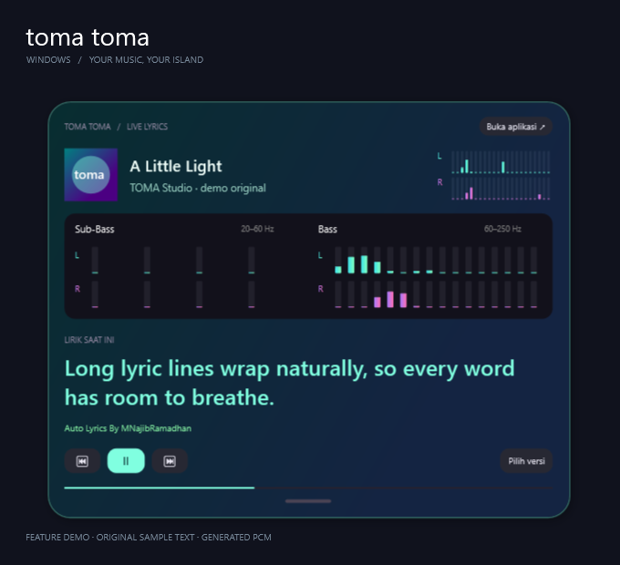
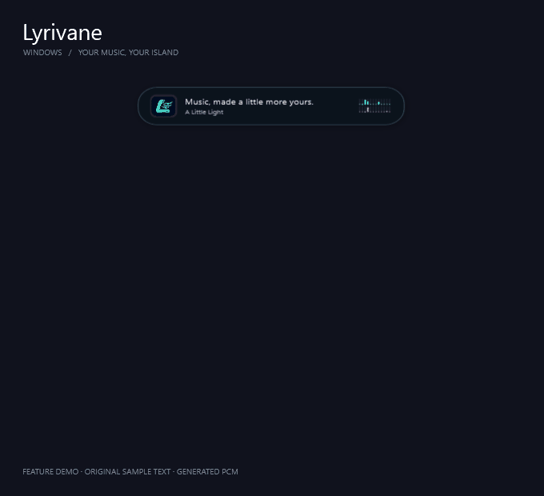
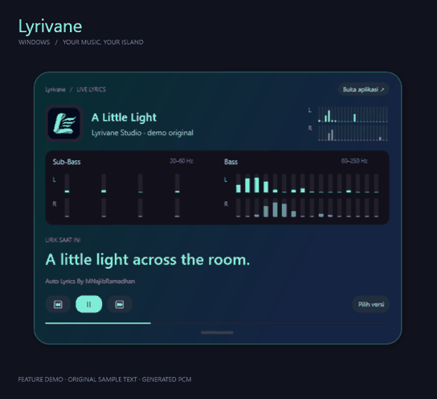
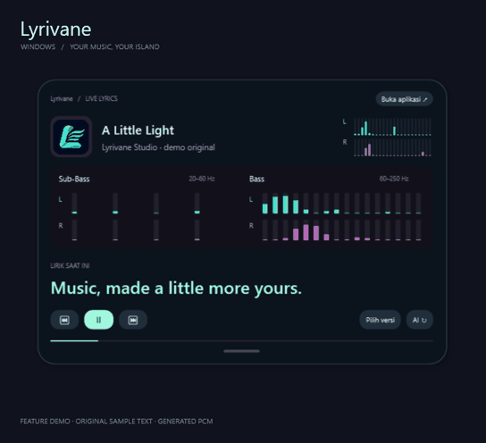

<div align="center">

# toma toma
### Your music. Your lyrics. Your island.

A small Windows companion that keeps lyrics, stereo spectrum, and playback controls close to your music.


[**Download Windows x64**](https://github.com/NJB-PROJECT/TOMA-TOMA-Windows/releases/latest) · [Feature clips](#lihat-fiturnya) · [Build from source](#build-dari-source) · [Privacy](PRIVACY.md)



</div>

## Musikmu, tanpa harus terus membuka pemutar

TOMA TOMA mengikuti sesi media Windows dari pemutar yang kompatibel, mencari lirik, lalu menampilkan baris aktif pada island di bagian atas monitor. Klik kapsul untuk membuka kartu; swipe ke atas untuk mengecilkannya. Klik di luar kartu membiarkannya tetap terbuka.

Proyek ini **khusus Windows**, gratis digunakan dan dimodifikasi di bawah lisensi MIT. Ini aplikasi pendamping independen; tidak berafiliasi dengan Spotify, YouTube, Xiaomi, atau Apple.

## Lihat fiturnya

### 01 / Kecil saat dibutuhkan. Besar saat diinginkan.


Kapsul ringkas, animasi buka/tutup, sampul, judul/artis, kontrol pemutar, dan lirik panjang yang turun ke baris berikutnya.

### 02 / Warna yang terasa milikmu.


Tema kapsul dan kartu besar **terpisah**. Pilih warna dasar, gradasi, teks, aksen lirik, garis tepi, transparansi, atau gambar background lokal. Ada preset Midnight, Aurora, Sunset, dan Ocean, preview langsung, Simpan, dan Batal.

### 03 / Lihat ruang stereo dan dentuman bass.


L cyan–mint, R ungu–pink. Kapsul mempunyai 12 band per kanal; kartu besar 22 band per kanal. Sub-Bass 20–60 Hz dan Bass 60–250 Hz memiliki lajur L/R sendiri, dengan masing-masing 4 dan 16 rentang frekuensi. Data berasal dari PCM melalui FFT, bukan pola batang acak.

> Klip di atas menampilkan komponen WPF aplikasi yang sebenarnya, dengan teks contoh original dan PCM sintetis berlabel **feature demo**. Klip ini ilustrasi fitur, bukan pengukuran latensi/FPS atau rekaman lagu komersial. [Versi video](docs/media/showcase.mp4).

## Apa yang tersedia?

| Fitur | Perilaku |
|---|---|
| Deteksi lagu | Mengikuti judul, artis, sampul dan posisi dari sesi media Windows yang kompatibel |
| Lirik otomatis | LRCLIB untuk timestamp; lyrics.ovh sebagai cadangan teks biasa |
| Pemilihan versi | Memilih alternatif ketika judul/artis/durasi belum cukup meyakinkan |
| Auto-sync | Baris aktif mengikuti posisi, jeda dan seek pemutar; koreksi waktu ±250 ms |
| LRC lokal | Impor `.lrc`/`.txt`, klik baris bertimestamp untuk seek |
| Pemutar eksternal | Spotify, YouTube Music di browser/PWA, dan pemutar yang mengekspos sesi media Windows |
| Audio lokal | Membuka format yang didukung decoder Windows |
| Desktop island | Always-on-top, pilihan monitor, kontrol pemutar, akses system tray |
| Personalisasi | Tema kecil/besar, solid/gradasi/gambar, warna teks dan opasitas background |
| Audio spectrum | WASAPI loopback, FFT Hann 4096, analisis stereo terpisah |

## Mulai dalam satu menit

1. Unduh ZIP **Windows x64** dari [Releases](https://github.com/NJB-PROJECT/TOMA-TOMA-Windows/releases/latest), lalu ekstrak seluruh isinya.
2. Buka `TOMA TOMA.exe`. Paket portable sudah menyertakan runtime .NET; tidak perlu installer.
3. Putar musik di aplikasi/browser yang menyediakan sesi media Windows. Tekan **Ikuti pemutar Windows** jika diperlukan.
4. Pilih versi lirik bila diminta. Klik kapsul untuk memperbesar; swipe kartu ke atas untuk mengecilkan.
5. Tekan **Personalisasi island** di sidebar untuk mengatur kedua ukuran kartu.

Menutup jendela utama menyembunyikannya ke system tray. Pilih **Keluar** dari tray untuk menghentikan aplikasi. Tidak ada autostart yang dipasang otomatis.

Target build: **Windows x64, Windows 10 build 19041 atau lebih baru / Windows 11**. Perilaku sesi media/seek bergantung pada pemutar. File EXE rilis saat ini belum ditandatangani dengan sertifikat code signing.

## Catatan yang berguna

- Link Spotify/YouTube membuka pemutar eksternal. Aplikasi ini tidak mengunduh lagu atau melewati pembatasan layanan.
- Lirik tanpa timestamp tetap diberi label. Windows belum menyediakan penyelarasan AI offline; tidak ada timestamp palsu yang dibuat.
- Spektrum membaca keluaran perangkat audio default, termasuk suara aplikasi lain. Pada format surround yang ditampilkan adalah pasangan **front L/R**, bukan semua kanal 5.1 atau meter LFE khusus.
- Tampilan spektrum menargetkan sekitar 60 Hz; latensi/FPS bergantung buffer audio, monitor, dan beban komputer. Spektrum dapat dimatikan dari sidebar.
- Jika perangkat output berganti, matikan lalu aktifkan **Spektrum audio nyata**. Always-on-top tidak menjamin tampil di atas fullscreen eksklusif atau layar keamanan Windows.
- Gambar background maksimal 20 MB, didekode dengan lebar maksimum 1200 px. Gambar tetap lokal; jika dipindahkan atau tidak bisa dibuka, aplikasi memakai warna dasar. Pilih warna teks yang kontras.

## Build dari source

Prasyarat: Windows, **.NET SDK 8**, PowerShell, akses NuGet untuk restore pertama.

```powershell
git clone https://github.com/NJB-PROJECT/TOMA-TOMA-Windows.git
cd TOMA-TOMA-Windows
./build.ps1
./build.ps1 -Publish
```

`build.ps1` memakai SDK lokal di `.tools/dotnet` bila ada, atau `dotnet` dari PATH. Publish menghasilkan executable self-contained di `dist/`. Script publish mengganti proses TOMA TOMA yang berjalan dari folder `dist` proyek ini.

Jalankan pengujian dari EXE hasil publish:

```powershell
& './dist/TOMA TOMA.exe' --self-test "$PWD/self-test.json"
```

Laporan JSON menyertakan total dan hasil tiap pengujian. Pengujian mencakup parser LRC, pencocokan lirik, FFT/stereo, layout lirik panjang, serta tema. Lihat [VALIDATION.md](VALIDATION.md).

Ekspor komponen WPF untuk membuat materi demo tanpa merekam desktop:

```powershell
& './dist/TOMA TOMA.exe' --showcase "$PWD/showcase-frames"
```

Mode showcase memakai data contoh sendiri, tidak memulai capture audio atau pencarian lirik, dan tidak menyimpan perubahan ke pengaturan pengguna. Ia menghasilkan frame PNG; tool penggabung video diperlukan untuk membuat MP4/GIF.

## Struktur proyek

```text
src/
  IslandWindow.*        # island, gesture dan animasi
  IslandAppearance.cs   # model tema, brush dan background lokal
  AppearanceWindow.cs   # editor tema dengan live preview
  PlayerState.cs        # state pemutar dan lirik
  LyricsClient.cs       # pencarian provider dan pemilihan hasil
  AudioSpectrum.cs      # WASAPI, FFT, stereo dan rendering
  SelfTest.cs           # pengujian deterministik
  ShowcaseExporter.cs   # ekspor demo dari visual WPF
```

## Kontribusi & lisensi

Bug report dan pull request dipersilakan. Baca [CONTRIBUTING.md](CONTRIBUTING.md) untuk cara menguji perubahan. Untuk laporan bug, jelaskan versi aplikasi, pemutar dan langkah reproduksi; jangan kirim token, cache lirik, atau rekaman pribadi.

Kode proyek berlisensi [MIT](LICENSE): boleh digunakan, dimodifikasi, dibagikan, dan digunakan secara komersial dengan mempertahankan pemberitahuan lisensi. Hak atas musik, sampul dan lirik tetap milik pemegang hak masing-masing; lisensi kode ini tidak memberikan hak atas konten pihak ketiga.

Dependensi: [NAudio 2.2.1](https://github.com/naudio/NAudio) (MIT), .NET/WPF dan Windows SDK. Lihat [THIRD_PARTY_NOTICES.md](THIRD_PARTY_NOTICES.md).

<div align="center">

**Auto Lyrics By MNajibRamadhan**  ·  Built by [NJB-PROJECT](https://github.com/NJB-PROJECT)

</div>
